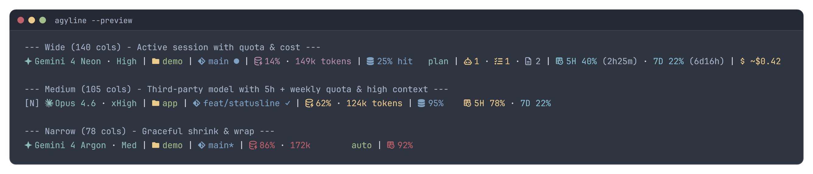

# agyline

A fast, zero-dependency, Cometix-style native Rust status line for [Antigravity CLI](https://antigravity.google/docs/cli/statusline) (`agy`).



## Features

- **Zero external crates (`std` only)**: compiles offline in seconds into a ~520 KB single binary with sub-10 ms startup, built-in JSON & TOML parsers, and no script-runtime overhead.
- **Cometix-style visual layout**:
  - **Left**: active model (with per-family Nerd Font icons for Gemini, Claude, OpenAI/Codex, DeepSeek, Copilot) + reasoning effort, Vim mode, tool confirmation indicator, workspace directory, Git branch/status/ahead-behind, context usage, prompt cache hit ratio.
  - **Right**: `cycle_mode` (`plan` / `auto` / `accept-edits`) with document, lightning, and pencil icons, live activity (running subagents, background tasks, artifacts), model-aware `5H` / `7D` rolling quota usage & reset countdown, estimated session cost.
- **Zero-block Git SWR cache**: reads `.git/HEAD` directly on the render path and refreshes `git status` asynchronously in a detached background worker (using `CreateProcessW` with `bInheritHandles = FALSE` on Windows to avoid pipe hangs).
- **4-step responsive layout**: gracefully shrinks right segments, then left segments, and wraps cleanly to two lines on narrow terminals.
- **State-aware terminal titles**: `--title` prints a plain-text title for agy's native `title.command`. On Windows, the existing watcher animates working and action-required indicators once per second and clears the completion indicator after five seconds. Direct Windows console title sync remains available for existing configurations.
- **Native terminal bell notifications on Windows**: work returning to idle and entering tool confirmation each emit one BEL notification through the session's console. Repeated callbacks and animation frames do not repeat the notification.
- **Windows orphan self-reaper & exit watcher**: one global background watcher waits on live `agy.exe` handles, title updates, and animation deadlines. It automatically reaps `0ms`-CPU `Suspended` orphaned copies (including hot-swap `.old.*` backups) whenever an `agy` session exits, then exits cleanly once the last `agy` closes. Process scans and periodic reaping keep their own slower schedules.

## Requirements

- Rust toolchain (`cargo` / `rustc`, edition 2021)
- A [Nerd Font](https://www.nerdfonts.com/) (v3.5+ recommended for native `nf-cod-claude` and `nf-cod-openai` glyphs), or pass `--classic` for plain Unicode fallback.

## Download Prebuilt Binaries

Prebuilt binaries for Windows (`x86_64`), Linux (`x86_64`), and macOS (`arm64` / `x86_64`) are published on the [GitHub Releases](https://github.com/TakiGuan/agyline/releases) page along with `SHA256SUMS.txt`.

## Build from Source

```bash
git clone https://github.com/TakiGuan/agyline.git
cd agyline
cargo build --release
```

Copy the compiled binary (`target/release/agyline.exe` on Windows or `target/release/agyline` on macOS/Linux) to a permanent location, for example `~/.antigravity/agyline.exe`.

## Antigravity CLI Configuration

Add `statusLine` and `title` to `~/.gemini/antigravity-cli/settings.json`:

```json
{
  "statusLine": {
    "type": "command",
    "command": "C:\\Users\\<you>\\.antigravity\\agyline.exe --no-title"
  },
  "title": {
    "type": "command",
    "command": "C:\\Users\\<you>\\.antigravity\\agyline.exe --title"
  }
}
```

The native [title command](https://antigravity.google/docs/cli/title) receives the same JSON as the status line. `--no-title` disables the status line's direct Windows title writes. The title command supplies the current frame to agy, and the Windows watcher supplies subsequent frames between callbacks. On Linux and macOS, use the installed executable's path in both commands.

On Windows, use an installation path without spaces and leave the executable path unquoted in these command strings. With agy 1.5.18, embedded quotes can reach `cmd.exe` as literal escaped characters and cause a "not recognized" error. Keep the doubled backslashes required by JSON.

Titles keep the conversation name, falling back to the workspace directory or `Antigravity`. A status icon precedes the name, without a text label or separator:

| State | Prefix |
| :--- | :--- |
| Tool confirmation pending, before any other state | `[ ! ]` ↔ `[ . ]` |
| Working, using tools, or reviewing | `◐` ↔ `◑` |
| Initializing or authenticating | `◐` ↔ `◑` |
| Idle with running background tasks or subagents | `◐` ↔ `◑` |
| Work or confirmation changes to idle, with no background work | `🟢` for five seconds, then no prefix |
| Initial idle or idle after an error | No prefix |
| Error | `🔴`, cleared on the next state change |
| Missing or unknown state | No prefix |

For example: `◐ Fix authentication` alternates with `◑ Fix authentication`. When work ends, it becomes `🟢 Fix authentication`, then `Fix authentication` after five seconds. Repeated idle callbacks do not extend the green indicator. A new conversation starts with fresh state. The green circle means agy returned to idle, including after cancellation, rather than asserting that the task or its tests succeeded.

Each animation frame lasts 1,000 ms, so a full cycle lasts two seconds. The existing Windows watcher handles animation in its wait loop, with no additional resident process or animation thread. Callbacks hand off small state files under the user's temporary directory, keyed by agy's process ID and creation time. The watcher checks that identity before attaching to each console and removes stale session files. The `--title` path skips Git lookups.

The watcher also sends a single BEL (`U+0007`) when work returns to idle or tool confirmation first becomes pending. It writes directly to the matching console, keeping captured status line and title output free of notification control characters. Initial idle, errors, and repeated callbacks do not ring. Pending notifications are consumed before delivery to avoid duplicates after a watcher restart, and notifications older than five seconds are discarded. A process interruption or an unavailable console can therefore drop a notification.

Windows Terminal controls the bell indicator and any sound or flashing through its existing settings, including `bellStyle`. agyline does not change those settings or track tab focus. The green completion circle keeps its existing five-second lifetime, independently of the terminal's bell indicator.

Titles are sanitized, limited to 60 display columns including the prefix, and contain no ANSI styling or Nerd Font icons. Their appearance depends on the terminal's title font. Emoji circle colors are supplied by the system font and cannot follow Nord palette values exactly.

Linux, macOS, `--no-watch`, and calls outside an agy process tree use a static first frame and plain idle title. They do not track completion or emit bell notifications. Existing Windows configurations without `title.command` use the same animation and notifications through direct title sync unless `--no-title` or `title = false` is set. When replacing a running installation, restart its watcher or close all agy sessions before reopening them, so the new watcher code is loaded.

## Configuration File (Optional)

`agyline` works out of the box with zero configuration. If you want to customize watcher timing, Git cache TTL, or visible segments without a long CLI command, generate a TOML config next to the binary:

```bash
agyline --init-config
```

On startup, `agyline` looks beside its own executable for `<exe_stem>.toml` first (for example `statusline.toml` when renamed to `statusline.exe`), then `agyline.toml`. Precedence is **CLI flags > TOML config > built-in defaults**.

```toml
glyphs = "nerd"          # "nerd" | "classic"
title = true             # Direct Windows title sync, disable when using title.command

[layout]
width = "auto"           # "auto" or integer column count
dir_style = "name"       # "name" | "parent" | "tilde"
quota_mode = "used"      # "used" | "remaining"

[git]
fast = false             # true = read .git/HEAD only (skip git status)
cache_ms = 5000          # SWR fresh cache TTL in ms
timeout_ms = 10000       # Background git status timeout in ms

[watcher]
enabled = true           # Windows single-instance agy.exe exit watcher
poll_ms = 30000          # Rescan interval for newly opened agy.exe (1000..300000)
exit_settle_ms = 500     # Wait after agy exit before reaping (100..5000)
reap_interval_secs = 60  # Periodic orphan reap interval (10..3600)
reap_min_age_secs = 15   # Min age for periodic orphan reap (1..3600)

[segments]
model = true
dir = true
git = true
context = true
cache = true
mode = true
vim = true
subagents = true
tasks = true
artifacts = true
quota = true
cost = true
```

## CLI Flags

| Flag | Description |
| :--- | :--- |
| `--classic`, `--no-nerdfont` | Use plain Unicode symbols instead of Nerd Font glyphs |
| `--dir-style name\|parent\|tilde` | Directory display style (default: `name`) |
| `--quota-mode used\|remaining` | Show quota as used % (default) or remaining % |
| `--fast-git` | Read `.git/HEAD` only and skip background `git status` |
| `--title` | Print a plain-text state-aware title from stdin JSON for agy's `title.command` |
| `--no-title` | Disable direct Windows title sync during status line rendering |
| `--no-watch` | Disable the single-instance Windows `agy.exe` exit watcher |
| `--no-model`, `--no-dir`, `--no-git`, `--no-context`, `--no-cache` | Hide individual left segments |
| `--no-mode`, `--no-vim`, `--no-activity`, `--no-quota`, `--no-cost` | Hide individual right segments |
| `--init-config` | Write a commented default `.toml` config file beside the binary |
| `--preview [--width N]` | Render sample payloads at wide, medium, and narrow widths |
| `--legend` | Print segment legend and available flags |
| `--version` | Print version string |

Set `NO_COLOR=1` to disable ANSI color output.

## Acknowledgements

- Visual design inspired by [Haleclipse/CCometixLine](https://github.com/Haleclipse/CCometixLine).
- Antigravity CLI payload conventions informed by [weby-homelab/antigravity-cli-statusline](https://github.com/weby-homelab/antigravity-cli-statusline) and the official Antigravity CLI documentation.
- Inspired by discussions and community sharing on [LINUX DO](https://linux.do).

## License

[MIT](LICENSE)
